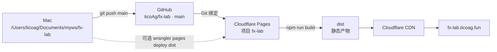

# 部署架构

fx-lab 是纯静态 SPA。没有应用服务器，没有数据库。
本机 Mac 只做控制面：写代码、推 GitHub、改 Pages 控制台配置。
GitHub `main` 是生产分支，Cloudflare Pages 拉源码、跑构建、把 dist 发到边缘。

线上：https://fx-lab.ticoag.fun/
Pages 默认域名 https://fx-lab-5do.pages.dev/ 仍指向同一项目。
仓库：https://github.com/ticoAg/fx-lab
Pages 项目：fx-lab
本机路径：/Users/ticoag/Documents/myws/fx-lab

## 链路



## 分工

| 角色 | 归属 | 做什么 |
| --- | --- | --- |
| 开发 | Mac 本机 | 改代码、本地 dev、push |
| 源码 | GitHub ticoAg/fx-lab | 公开仓库，生产分支 main |
| CI | Cloudflare Pages 构建 | 克隆 main，Node 20，`npm run build` |
| 托管 | Cloudflare Pages 项目 fx-lab | 存放并发布 dist |
| 边缘 | Cloudflare CDN | 分发 fx-lab.ticoag.fun，以及 fx-lab-5do.pages.dev |

首次上线走的是 Wrangler Direct Upload，现在控制台已绑定 Git。Wrangler CLI 不能绑定 Git 源。

## 配置放哪

| 配置 | 位置 | 值 |
| --- | --- | --- |
| 构建命令 | Pages 控制台 Build configuration | `npm run build` |
| 构建输出目录 | Pages 控制台 | `dist` |
| 根目录 | Pages 控制台 | 留空（仓库根） |
| 框架预设 | Pages 控制台 | Vite；上面两项填了也可选 none |
| 生产分支 / 自动部署 | Pages 控制台 | main，自动部署开 |
| 构建系统版本 | Pages 控制台 | Version 3 |
| 项目名 / 产物目录声明 | wrangler.toml | `name = "fx-lab"`，`pages_build_output_dir = "./dist"` |
| Node 版本 | .nvmrc | `20` |
| SPA 回退 | public/_redirects | `/* /index.html 200` |
| 静态资源缓存头 | public/_headers | 见下文"CDN 与缓存" |
| 站点自定义域名 | Pages 项目 fx-lab → Custom domains | `fx-lab.ticoag.fun`，CNAME 到 `fx-lab-5do.pages.dev`，已代理 |
| 资源 CDN 地址 | src/cdn.ts | `https://fx-lab-cdn.ticoag.fun` |
| 本地 dev 端口、`assetsInclude` | vite.config.ts | 本地与构建配置，不是 Pages 设置 |

构建命令只在控制台。wrangler.toml 里不写构建命令。

wrangler.toml 必须保持：

```
name = "fx-lab"
compatibility_date = "2026-08-23"
pages_build_output_dir = "./dist"
```

package.json 的 `build` 脚本是 `npm run check:svg-kits && tsc -b && vite build`，控制台里填的 `npm run build` 就是它。SVG Kits 校验（scripts/check-svg-kits.ts，经 tsx 运行）只检查 `seed/svg-kits` 种子，不过则 Pages 构建失败。

`functions/` 是 Cloudflare Pages Functions：`/api/svg-kits` 给画廊和上传用。没有 R2 绑定时 GET 仍能读种子，上传不可用。绑定方法见 [svg-kits.md](svg-kits.md)。不要在 wrangler.toml 加 `[build]`。

## CDN 与缓存

站点本身是静态的。两类资源各走一条免费路径，浏览时不调用 Pages Functions。

### Pages 静态资源

Pages 默认把上传的静态文件放在边缘 Tiered Cache 里，请求免费不限量。`public/_headers` 再给浏览器加缓存：

| 路径 | Cache-Control | 原因 |
| --- | --- | --- |
| `/assets/*` | `public, max-age=31536000, immutable` | Vite 产物，文件名带内容哈希 |
| `/ph/*`、`/seed-svg-kits/*`、`/sketchbook/*`、`/models/*`、landing-pages 的素材目录、`/favicon.svg`、`/icons.svg` | `public, max-age=86400` | 文件名固定，缓存一天 |
| HTML | 不改（Pages 默认 `max-age=0, must-revalidate`） | 新部署立刻生效 |

不要在 zone 上给 Pages 站点加"缓存一切"的规则：Pages 官方不建议，部署后会读到旧页面。

### R2 走 CDN：`https://fx-lab-cdn.ticoag.fun`

R2 桶 `fx-lab-svg-kits` 绑了自定义域名 `fx-lab-cdn.ticoag.fun`（zone `ticoag.fun`），整个桶通过它公开只读。桶里只有 SVG Kits 主题（`index.json`、`themes/<id>/...`）和 3D 模型（`models/3d/*.glb`），没有机密；管理口令是 Pages 环境变量。

| 配置 | 值 | 怎么查 |
| --- | --- | --- |
| 自定义域名 | `fx-lab-cdn.ticoag.fun`，最低 TLS 1.2 | `cf r2 buckets domains custom list --bucket-name fx-lab-svg-kits` |
| CORS | 来源 `*`，方法 GET、HEAD | `cf r2 buckets cors get fx-lab-svg-kits` |
| 缓存规则 | zone `ticoag.fun` 的 `http_request_cache_settings`，`http.host eq "fx-lab-cdn.ticoag.fun"`：边缘 1 天（4xx 只缓存 60 秒，新上传的文件不会被旧的 404 挡一天），浏览器 1 天 | `cf rulesets list --zone <zone id>` |
| SSL/TLS | zone 级 Full (strict)，最低 TLS 1.2 | `cf zones settings get ssl --zone <zone id>` |
| Smart Tiered Cache | zone 级开启，未命中时先问上层数据中心，少回源 R2 | 控制台 Caching → Tiered Cache |

前端地址只在 `src/cdn.ts` 定义：

- 3D 模型：FluidGlass（lens、cube、bar）、ModelViewer（sunglasses）用 `modelUrl()`，开发和线上都从 CDN 读。文件来自 react-bits 仓库 `public/assets/3d/`。
- SVG Kits：线上浏览页读 `CDN/index.json`、`CDN/themes/<id>/manifest.json` 和图标，再合并构建产物里的种子；CDN 失败时退回 `/api/svg-kits`。管理页 `/svg-kits/admin` 始终读 API，看到的是最新数据。本地 dev 不走 CDN。

站点域名 `fx-lab.ticoag.fun` 绑的是 Pages。资源 CDN 不绑到 Pages：Pages Functions 跑在缓存前面，即使缓存命中也计入 Workers 每天 10 万次的额度。绑到 R2 的请求不经过 Functions，CDN 命中也不算 R2 读取。

上传或替换模型：

```bash
cf r2 objects put models/3d/lens.glb --bucket-name fx-lab-svg-kits \
  --content-type model/gltf-binary --body @path/to/lens.glb
```

上传新主题或替换文件后，访客最多 1 天后看到新内容。要立即生效，按 URL 清缓存（包括 `index.json` 和该主题的 `manifest.json`，每次最多 30 个 URL）：

```bash
cf cache purge --zone <zone id> --force --body '{"files":[
  "https://fx-lab-cdn.ticoag.fun/index.json",
  {"url":"https://fx-lab-cdn.ticoag.fun/index.json","headers":{"Origin":"https://fx-lab.ticoag.fun"}},
  {"url":"https://fx-lab-cdn.ticoag.fun/index.json","headers":{"Origin":"https://fx-lab-5do.pages.dev"}}
]}'
```

R2 开了 CORS，响应带 `Vary: Origin`，CDN 按请求有没有 `Origin` 头分开缓存。浏览器请求带 `Origin`，所以每个地址都要清：不带头的一份，以及 `https://fx-lab.ticoag.fun` 和 `https://fx-lab-5do.pages.dev` 各一份。只清不带头的那份，用 curl 看是新的，浏览器里仍是旧的。

也可以在控制台 ticoag.fun → Caching → Purge Cache 操作。

### 不存在的文件

`public/_redirects` 的 SPA 回退会把任何不存在的路径答成 `index.html`、状态 200，`/assets/*` 下还会带上一年的 immutable 头。Pages 的 `_redirects` 不支持 404 改写，所以代码里这样处理：

- 发版后，旧标签页按旧哈希加载懒加载的 chunk 会失败。`src/main.tsx` 监听 `vite:preloadError`，自动刷新一次拿新的 `index.html`。
- SVG Kits 读种子文件时，把 `text/html` 响应当作不存在（`client.ts` 的 `isFound`、`useSvgSource.ts`）。

## 免费额度

本项目只用免费计划，不绑付款方式。

| 资源 | 免费额度 | 本项目用量 |
| --- | --- | --- |
| Pages 构建 | 500 次/月，同时 1 个 | 每次 push（含预览分支）一次 |
| Pages 静态请求 | 不限 | 页面、JS、图片、种子 SVG |
| Pages Functions | 计入 Workers：10 万次/天，每次 10 ms CPU | 只有 `/api/svg-kits/*`：管理页读写，以及 CDN 不可用时的回退 |
| R2 | 10 GB 存储，Class A 100 万/月，Class B 1000 万/月，出口流量免费 | 只有 CDN 未命中时才读 R2 |
| Cache Rules | 每个 zone 10 条 | 用 1 条 |

Pages CI 会按 `functions/` 目录自动生成 `_routes.json`，只有 `/api/svg-kits/*` 会调用 Functions。不要加 `/*` 这类会匹配全部路径的 Function。项目设置为 fail open：Functions 当天额度用完后跳过 Functions，只返回静态资源，此时只有管理页不可用。

## 发布流程

1. 本机 `git push` 到 `main`。
2. Pages 克隆仓库 main。
3. 按 .nvmrc 用 Node 20。
4. 跑 `npm run build`，产出 dist。
5. 上传 dist，发到 CDN。fx-lab.ticoag.fun 和 fx-lab-5do.pages.dev 同时生效。

dist/ 和 node_modules/ 都在 .gitignore 里，由 Pages 构建生成。
本文撰写时最后一次成功的 Git 部署是提交 `8204db3`，即删掉不支持的 `[build]` 键那次。

## 可选：绕过 Git 直传

本地构建后直传，不影响已有的 Git 绑定。

```
npm run build
npx wrangler pages deploy dist --project-name fx-lab
```

## 坑

- wrangler.toml 里绝不要加 `[build]` 表。那是 Workers 专用键，Pages 会拒绝，Git 构建几秒内失败。
- 控制台的构建命令和输出目录不要留空，否则构建不出 dist。
- 框架预设别选 CRA，选 Vite 或 none。
- 别把 dist 提交进仓库。
- `wrangler pages download config --force` 会用控制台的值覆盖本地 toml；控制台当时为空就会把本地写空。

## 本地命令

```
npm install
npm run dev      # 127.0.0.1:5173，端口在 vite.config.ts 里固定
npm run build
npm run preview
```
